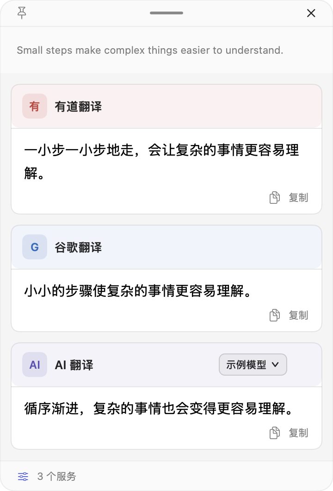
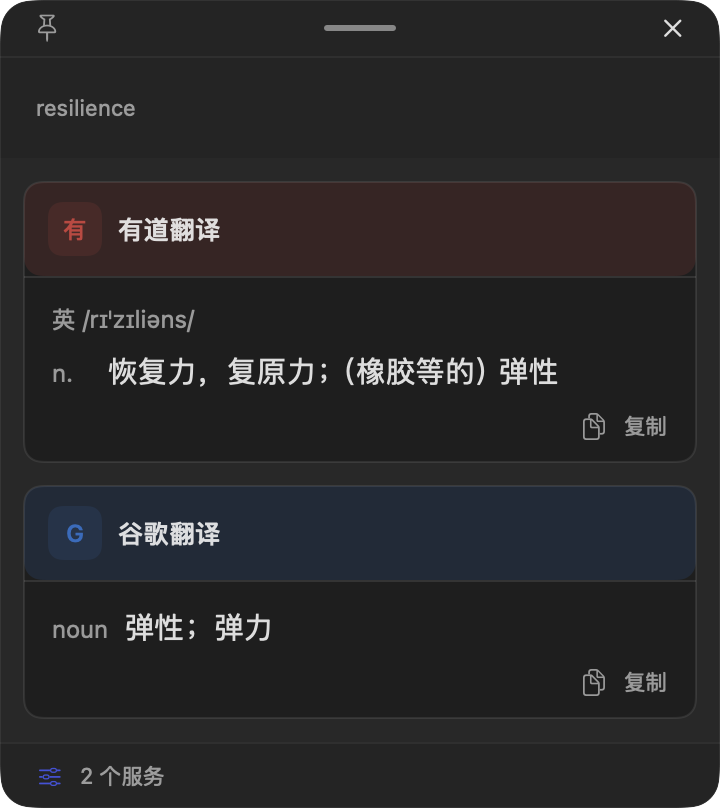
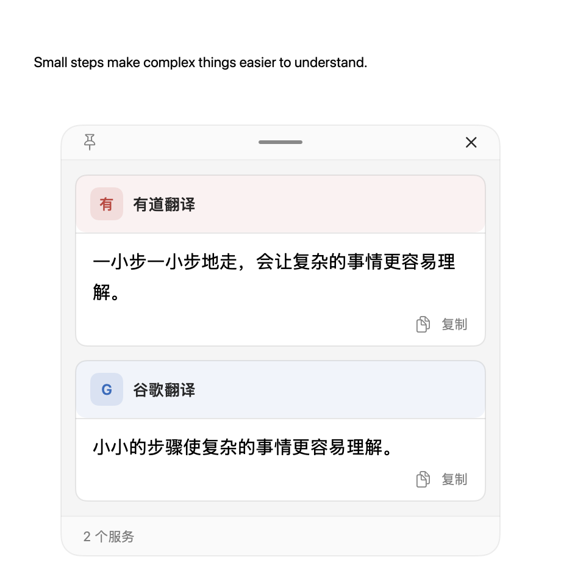
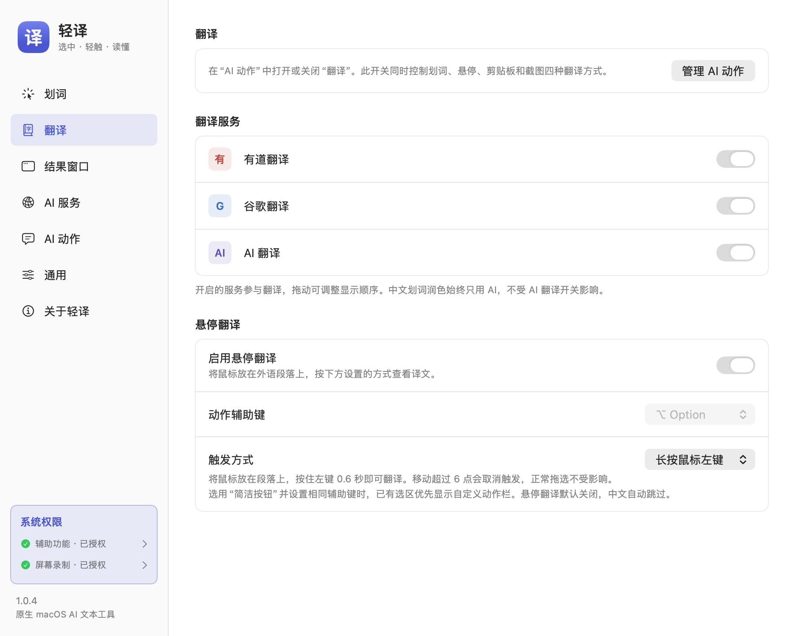
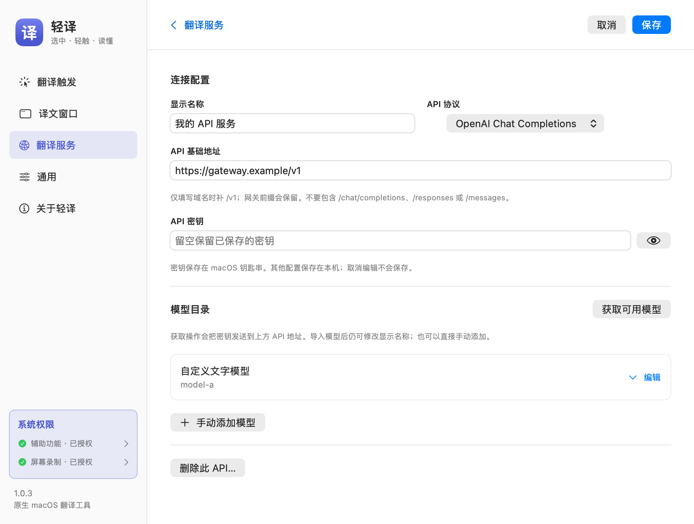
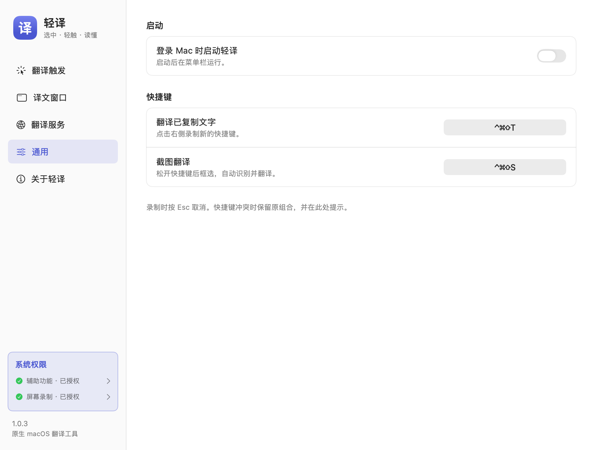

# 轻译 Qingyi

**1.0.3** · 在 Mac 上选中外语、悬停在段落上，或框选图片中的文字，就能在同一个浮窗对照中文译文。支持 Apple Silicon 和 macOS 14 及更高版本。

当前维护构建为 1.0.3（build 66），修复同邮箱 ChatGPT 连接隔离。已发布版本入口为 [1.0.3](https://github.com/djoldwang/qingyi/releases/tag/v1.0.3)。

[下载 1.0.3](https://github.com/djoldwang/qingyi/releases/tag/v1.0.3) · [使用手册](docs/usage.md) · [版本记录](CHANGELOG.md)

## 同一句话，各家怎么译

有道和谷歌默认开启，安装后即可使用。AI 开关也默认开启，选好自己的 ChatGPT 或自定义 API 模型后，浮窗会增加一张 AI 卡片。原文只显示一次，点击某张卡片下方的“复制”即可复制该家的结果。长译文可以滚动阅读。

英文单词会展示服务实际提供的音标、词性与释义。下图为深色外观下的查词示例。

## 四种翻译入口

| 场景 | 操作 |
| --- | --- |
| 可选中的正文 | 选中文字并松开鼠标，移入或点击“译”。 |
| 正在阅读的段落 | 在“设置 → 翻译触发”开启悬停翻译，用长按鼠标或选定的修饰键触发。 |
| 已复制的文字 | 按 **⌃⌘⇧T**，也可以从菜单栏选择“翻译已复制文字”。 |
| 图片或扫描件 | 按 **⌃⌘⇧S**，松开快捷键后框选。Vision 在本机识别，翻译服务收到的是文字。 |

下图上方为示例截图，下方为对应的原生译文浮窗。文档配图使用独立的示例数据。

## 设置与界面

在“设置 → 翻译服务”中点击小开关选择服务，按住整行即可拖动排序。当前浮窗会直接重排已有结果。某一家失败时，可在该卡片上单独重试。

查看翻译触发、译文窗口、自定义 API 和通用设置

**翻译触发** · 分别设置划词与悬停，并选择需要排除的应用。

**译文窗口** · 选择浮窗出现的位置，调节字号，用预览检查阅读效果。

**自定义 API** · 填写服务地址与凭据，选择协议并导入或手动添加模型。支持 OpenAI Chat Completions、OpenAI Responses 和 Anthropic Messages。

**通用** · 录制剪贴板与截图快捷键，设置登录时启动。侧栏底部可以查看系统权限。

## 安装与首次使用

1. 从 Release 下载安装包。使用 DMG 时将轻译拖入“应用程序”，使用 ZIP 时先解压。更新时退出轻译，再覆盖原安装位置。
2. 打开轻译，从菜单栏“译”进入设置。通过侧栏底部“系统权限”开启划词、悬停需要的辅助功能权限，以及截图翻译需要的屏幕录制权限。安装包使用固定 Qingyi 证书签名，未经 Apple 公证。
3. 选中一句英文试用。要加入 AI 对照，在“翻译服务”中连接 ChatGPT 或添加自定义 API，再选择翻译服务和模型。凭据保存在 macOS 钥匙串。

## 翻译服务与隐私

划词检测和截图识别在本机进行。触发翻译时，轻译会将原文发送给已开启的有道、谷歌和已配置的 AI 服务。

有道优先通过原生 HTTPS 请求公开 JSON 接口取得普通译文或词典字段，核对原文回显，复用网络连接。启动和启用有道时只预热连接，不发送原文；暂停或关闭服务时取消预热。长文按自然段组织，超长单段按句子或词间边界划分，每次不超过公开服务的完整输入上限，最多六路并发，再按原顺序显示。代码、网址、版本和标记会在译文中还原。各批之间不共享整篇上下文，这一取舍用于减少等待。

协议变化、原文回显不完整或代码标识无法还原时，保留移动页面、整篇原生请求、匿名流式和 WebKit 回退，回退可能更慢。临时签名、解密参数及匿名会话仅短时保存在内存。谷歌通过网页翻译接口取得结果。网页变更、网络环境和服务限流都可能影响可用性。两家内置服务单次最多接收 5,000 字。

支持关闭思考的 AI 模型默认开启「快速翻译」。如果网关明确表示当前模型不支持快速模式，轻译会用同一模型的默认模式重试一次，并在本机记住这个服务配置和模型。以后的翻译直接走默认模式，重启后也有效。如果网关只是返回空译文，则仅在当次重试一次。

在「翻译服务」中可以查看上次译文是否经过重试、模型报告的思考状态，以及当前模型使用默认模式的原因。网关升级后，可点「下次重新尝试快速模式」。原文、译文和思考内容不会写入翻译历史。使用 AI 卡片的模型菜单切换模型时，只会为当前原文重新请求该 AI 模型。账号管理、API 配置、快捷键冲突和源码构建详见[使用手册](docs/usage.md)。

## 开源许可

轻译的当前代码、资源与文档整体采用 [GNU GPL 第 3 版（GPL-3.0-only）](LICENSE) 授权。

Copyright (c) 2026 Qingyi contributors。当前翻译服务的实现及协议参考见[第三方服务与许可证](THIRD_PARTY_NOTICES.md)。

历史版本当前重新授权与既有许可权利说明见 [RELICENSING.md](RELICENSING.md)。
